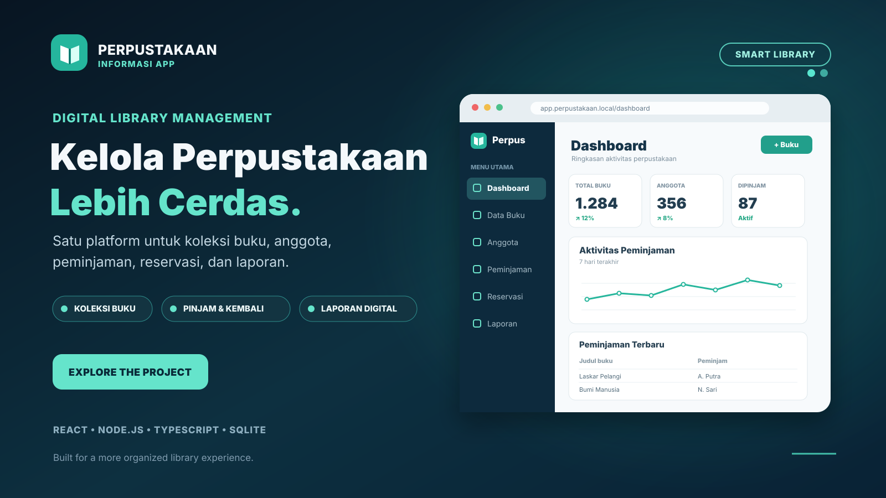
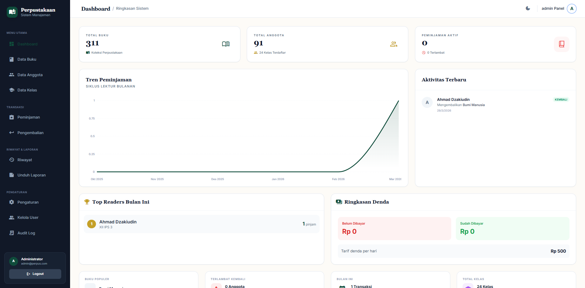
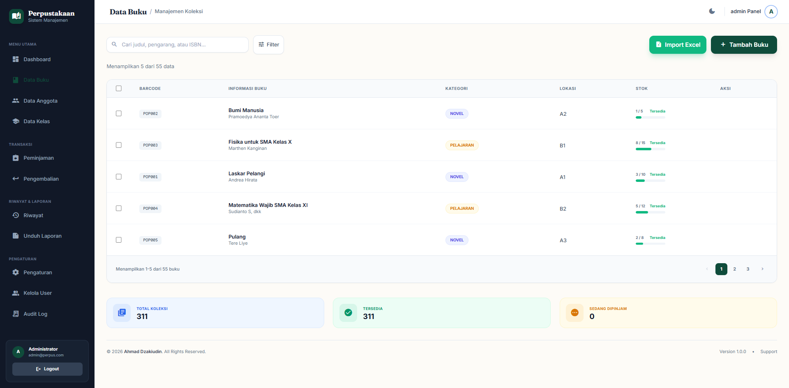
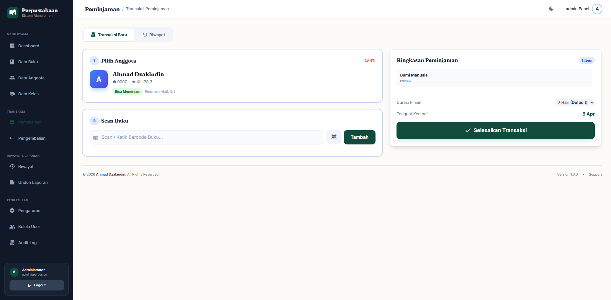

<!--
  Perpustakaan Informasi APP
  Promotional banner created for this repository.
-->

<p align="center">
  
</p>

<h1 align="center">Perpustakaan Informasi APP</h1>

<p align="center">
  Sistem manajemen perpustakaan digital untuk mengelola koleksi buku, anggota, transaksi peminjaman, reservasi, dan laporan dalam satu platform.
</p>

<p align="center">
  
  
  
  
</p>

<p align="center">
  <a href="#fitur-utama">Fitur</a> ·
  <a href="#pratinjau-aplikasi">Pratinjau</a> ·
  <a href="#instalasi">Instalasi</a> ·
  <a href="#dokumentasi-api">API</a>
</p>

---

## Tentang Proyek

**Perpustakaan Informasi APP** adalah aplikasi manajemen perpustakaan berbasis web yang dirancang untuk membantu proses operasional perpustakaan menjadi lebih terstruktur. Proyek ini menggunakan pendekatan *monorepo* dengan aplikasi *frontend* React dan layanan *backend* Node.js + Express.

## Fitur Utama

| Fitur | Deskripsi |
|---|---|
| Dashboard | Ringkasan statistik dan aktivitas perpustakaan. |
| Manajemen buku | Pengelolaan data buku, ISBN lookup, kode batang, dan lokasi rak. |
| Manajemen anggota | Pengelolaan data anggota, termasuk siswa dan guru. |
| Peminjaman dan pengembalian | Pengelolaan transaksi buku serta dukungan pemindaian QR/kode batang. |
| Reservasi buku | Antrean reservasi buku yang sedang dipinjam. |
| Laporan | Pembuatan laporan dalam format PDF dan Excel. |
| Manajemen pengguna | Pembagian akses berdasarkan peran Admin dan Pustakawan. |
| Audit log | Pencatatan aktivitas pengguna. |
| Dokumentasi API | Dokumentasi endpoint melalui Swagger UI. |
| Desain responsif | Antarmuka untuk perangkat desktop, tablet, dan ponsel. |

## Pratinjau Aplikasi

Berikut adalah ilustrasi antarmuka untuk menggambarkan alur dan tampilan aplikasi.

<table>
  <tr>
    <td width="50%">
      <p align="center"><strong>Dashboard</strong></p>
      
    </td>
    <td width="50%">
      <p align="center"><strong>Manajemen Koleksi Buku</strong></p>
      
    </td>
  </tr>
  <tr>
    <td colspan="2">
      <p align="center"><strong>Transaksi Peminjaman</strong></p>
      
    </td>
  </tr>
</table>

> Catatan: gambar di atas merupakan ilustrasi antarmuka. Ganti gambar dengan tangkapan layar aktual aplikasi ketika tersedia.

## Teknologi yang Digunakan

### Frontend
- **React 18** dan **Vite** untuk antarmuka dan proses *build*.
- **TypeScript** untuk pengetikan statis.
- **Tailwind CSS** untuk pengaturan tampilan.
- **React Router DOM** untuk navigasi halaman.
- **Recharts** untuk visualisasi data.
- **Axios** untuk komunikasi HTTP.
- **jsPDF** untuk pembuatan dokumen PDF.
- **html5-qrcode** untuk pemindaian QR/kode batang.

### Backend
- **Node.js** dan **Express** untuk layanan API.
- **TypeScript** untuk pengetikan statis.
- **Prisma ORM** untuk akses basis data.
- **SQLite** sebagai basis data.
- **JWT** dan **BcryptJS** untuk autentikasi dan pengamanan kata sandi.
- **Winston** untuk pencatatan log.
- **Multer** untuk unggahan berkas.
- **Swagger** untuk dokumentasi API.
- **PDFKit** dan **ExcelJS** untuk laporan.
- **Nodemailer** untuk pengiriman email.
- **bwip-js** dan **qrcode** untuk pembuatan kode batang dan QR.

## Persyaratan

Pastikan perangkat sudah memiliki:

- [Node.js](https://nodejs.org/) versi 18 atau lebih baru.
- [Git](https://git-scm.com/).
- **npm**, yang disertakan bersama Node.js.

Proyek ini menggunakan SQLite sehingga tidak memerlukan server basis data terpisah.

## Instalasi

### 1. Clone repositori

```bash
git clone https://github.com/Dzakiudin/Perpusstakaan-Informasi-APP.git
cd Perpusstakaan-Informasi-APP
```

### 2. Pasang dependensi

```bash
npm run install:all
```

### 3. Siapkan konfigurasi lingkungan

Salin berkas contoh konfigurasi:

```bash
cp backend/.env.example backend/.env
```

Buka `backend/.env` dan sesuaikan nilainya dengan lingkungan lokal. Contoh berikut adalah format konfigurasi; gunakan *secret* milik sendiri dan jangan pernah mengunggah kredensial ke repositori.

```env
DATABASE_URL="file:./dev.db"
JWT_SECRET="ganti-dengan-secret-key-anda"
PORT=3001

# Opsional: konfigurasi email
SMTP_HOST="smtp.gmail.com"
SMTP_PORT=465
SMTP_USER="email-anda@gmail.com"
SMTP_PASS="app-password-anda"
```

### 4. Siapkan basis data

```bash
cd backend
npx prisma migrate dev --name init
npx prisma db seed
cd ..
```

### 5. Jalankan aplikasi

Buka dua terminal dari direktori utama proyek.

**Terminal 1 — Backend**

```bash
npm run dev:backend
```

**Terminal 2 — Frontend**

```bash
npm run dev:frontend
```

Jika konfigurasi bawaan belum diubah, alamat lokal yang digunakan:

| Layanan | Alamat |
|---|---|
| Frontend | http://localhost:5173 |
| Backend API | http://localhost:3001 |
| Swagger UI | http://localhost:3001/api-docs |

## Akun Awal

Jika proses *seed* menyediakan akun demo, README proyek sebelumnya mencantumkan kredensial berikut:

| Peran | Email | Kata sandi |
|---|---|---|
| Admin | `admin@perpus.com` | `admin123` |
| Pustakawan | `pustakawan@perpus.com` | `pustakawan123` |

Gunakan akun tersebut hanya untuk pengembangan lokal. Ganti kredensial bawaan sebelum aplikasi digunakan di lingkungan nyata.

## Dokumentasi API

Setelah backend berjalan, buka Swagger UI:

```text
http://localhost:3001/api-docs
```

## Struktur Proyek

```text
Perpusstakaan-Informasi-APP/
├── frontend/                 # Antarmuka React + Vite
│   ├── src/
│   │   ├── components/       # Komponen antarmuka
│   │   ├── pages/            # Halaman aplikasi
│   │   ├── services/         # Klien API
│   │   └── App.tsx            # Komponen utama
│   └── package.json
├── backend/                  # API Node.js + Express
│   ├── src/
│   │   ├── controllers/      # Pengendali permintaan
│   │   ├── routes/           # Rute API
│   │   ├── services/         # Logika bisnis
│   │   ├── middleware/       # Middleware
│   │   ├── utils/             # Utilitas
│   │   └── app.ts             # Titik masuk aplikasi
│   ├── prisma/
│   │   ├── schema.prisma     # Skema Prisma
│   │   └── seed.ts             # Data awal
│   └── package.json
├── docs/                     # Aset gambar dan dokumentasi visual
├── database_guide.md         # Panduan pengelolaan basis data
├── package.json              # Konfigurasi monorepo
└── README.md
```

## Pengelolaan Basis Data

Baca [database_guide.md](./database_guide.md) untuk panduan lebih lanjut, termasuk penggunaan DB Browser for SQLite, Prisma Studio, *seeding*, dan *migration*.

Perintah yang umum digunakan dari direktori yang sesuai:

```bash
npx prisma studio
npx prisma migrate dev
npx prisma db seed
```

## NPM Scripts

### Dari direktori utama

| Perintah | Keterangan |
|---|---|
| `npm run install:all` | Memasang dependensi proyek. |
| `npm run dev:frontend` | Menjalankan frontend dalam mode pengembangan. |
| `npm run dev:backend` | Menjalankan backend dalam mode pengembangan. |
| `npm run build` | Menjalankan skrip build pada workspace. |
| `npm run test` | Menjalankan skrip pengujian yang tersedia. |

### Skrip backend

| Perintah | Keterangan |
|---|---|
| `npm run db:migrate -w backend` | Menjalankan migrasi basis data. |
| `npm run db:seed -w backend` | Menambahkan data awal. |
| `npm run db:reset -w backend` | Mereset basis data sesuai skrip backend. |
| `npm run test -w backend` | Menjalankan pengujian backend. |

Ketersediaan perintah khusus backend mengikuti skrip yang didefinisikan dalam `backend/package.json`.

## Kontribusi

Saran dan perbaikan dapat diajukan melalui *issue* atau *pull request* di repositori ini.

## Lisensi dan Hak Cipta

© 2026 **Ahmad Dzakiudin**. Seluruh hak cipta dilindungi. Silakan baca berkas [LICENSE](./LICENSE) untuk ketentuan penggunaan.

---

<p align="center">
  Dibangun untuk membantu pengelolaan perpustakaan menjadi lebih terorganisasi.
</p>
